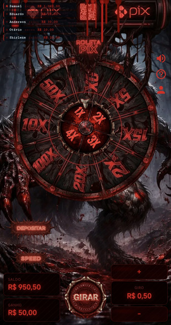

# Script de Roleta

**Script de roleta com PIX, sons e painel administrativo.**

---

## 📖 Sobre

Versão alternativa do script de roleta em PHP, com apostas PIX via Ecompag, animação, arquivos de som personalizáveis (incluindo versões antigas) e painel administrativo em `/admin`.

## ✨ Recursos

| Módulo | Descrição |
|---|---|
| Roleta | Giro animado com prêmios configuráveis |
| PIX Ecompag | Apostas e créditos automáticos |
| Admin | Painel em `/admin` |
| Sons | `assets/sounds` — win, spin, loss e faixa1 |
| Versões antigas | Arquivos `olds` para personalizar |
| Histórico | Rodadas e resultados |

## 🖼️ Prévia

## 📦 Instalação

1. Envie os arquivos para a hospedagem (PHP 8+ e MySQL/MariaDB).
2. Crie o banco e importe o SQL do pacote.
3. Configure o banco em `db.php`.
4. Acesse `/admin` com `admin` / `qwe123` e **troque a senha**.
5. Configure as credenciais da [Ecompag](https://ecompag.com).
6. Troque os áudios em `assets/sounds` se quiser.

## ⬇️ Download

📦 **[Release v1.0](https://github.com/VSFLima/script-roleta/releases/tag/v1.0)**

| Arquivo | Tamanho |
|---|---|
| [`roleta2.zip`](https://github.com/VSFLima/script-roleta/releases/download/v1.0/roleta2.zip) | 59 MB |

## ⚠️ Aviso

Este projeto é disponibilizado no estado em que foi recebido, para fins de estudo e implantação. Conteúdo destinado a maiores de 18 anos. Jogue com responsabilidade. A legalidade de apostas varia de país para país — verifique a legislação local. Troque todas as credenciais padrão antes de usar em produção.

## 🙏 Créditos

- **Distribuição:** [@vsf_lima](https://t.me/vsf_lima) — Telegram
- **Sistema original:** jc_scripts / ecompag

---

Feito com ❤️ para a comunidade — <a href="https://t.me/vsf_lima">@vsf_lima</a>

